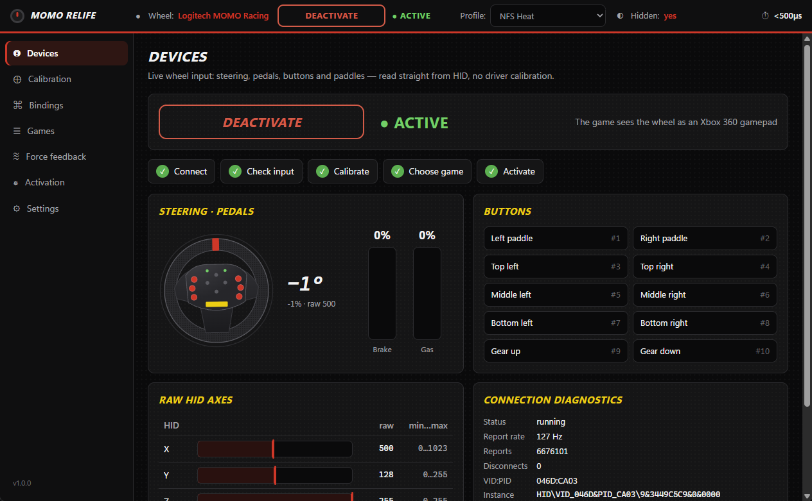
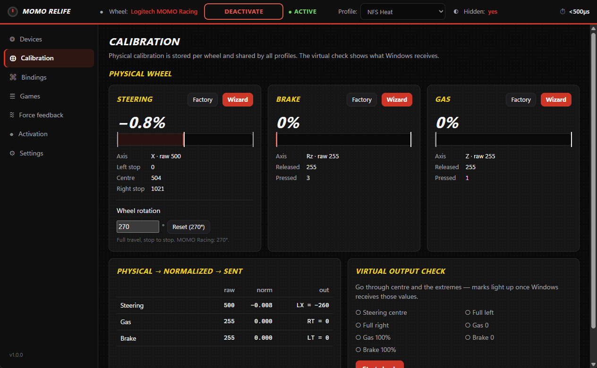
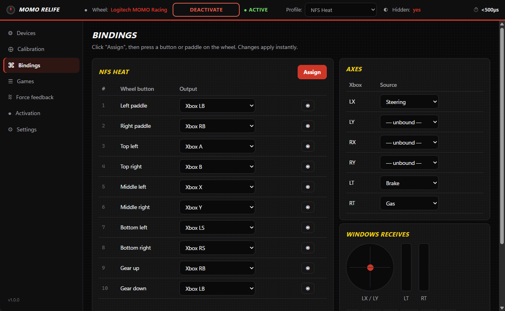
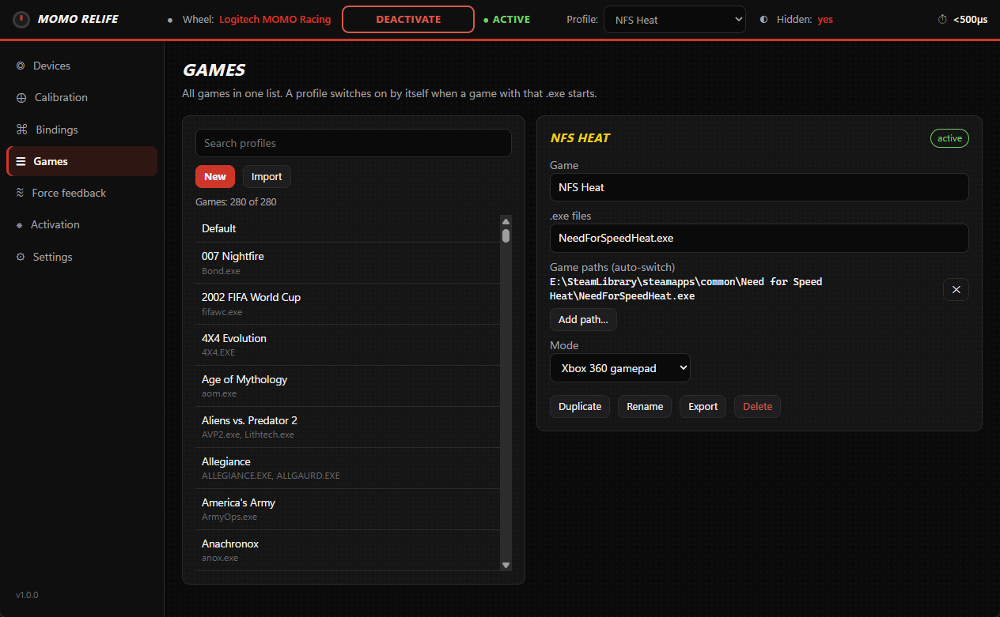
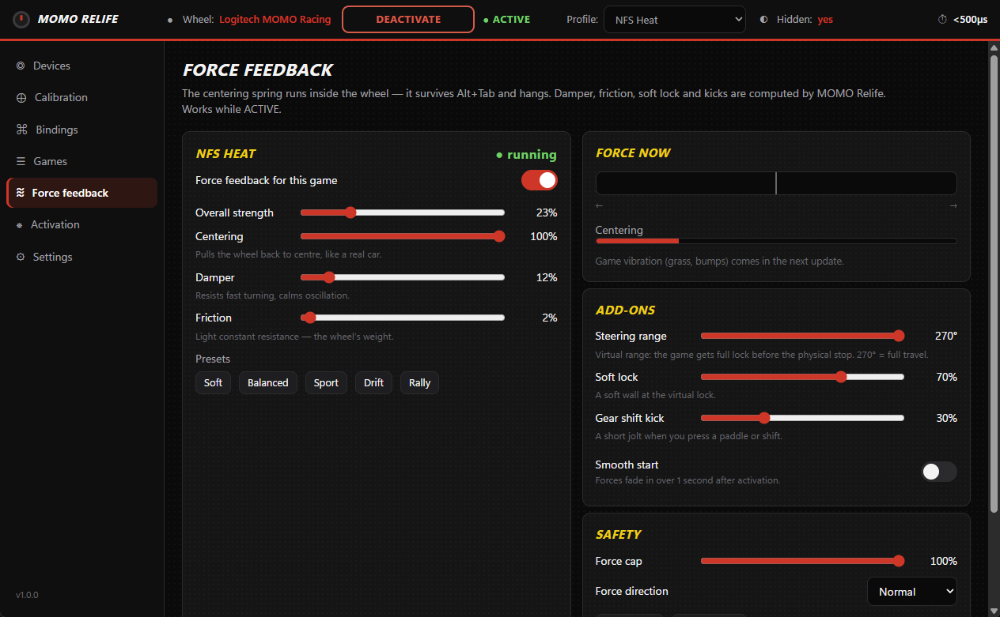
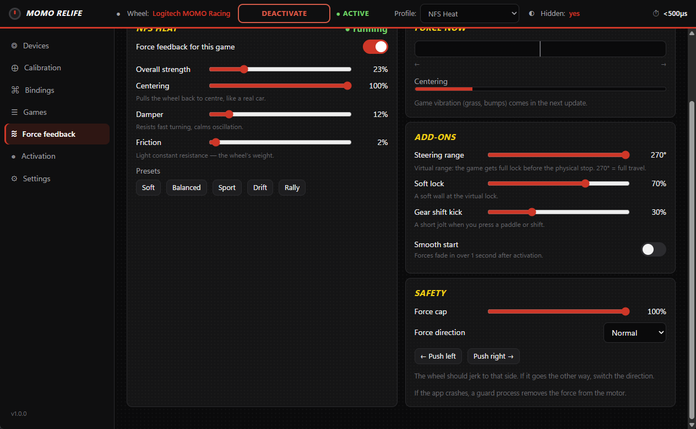
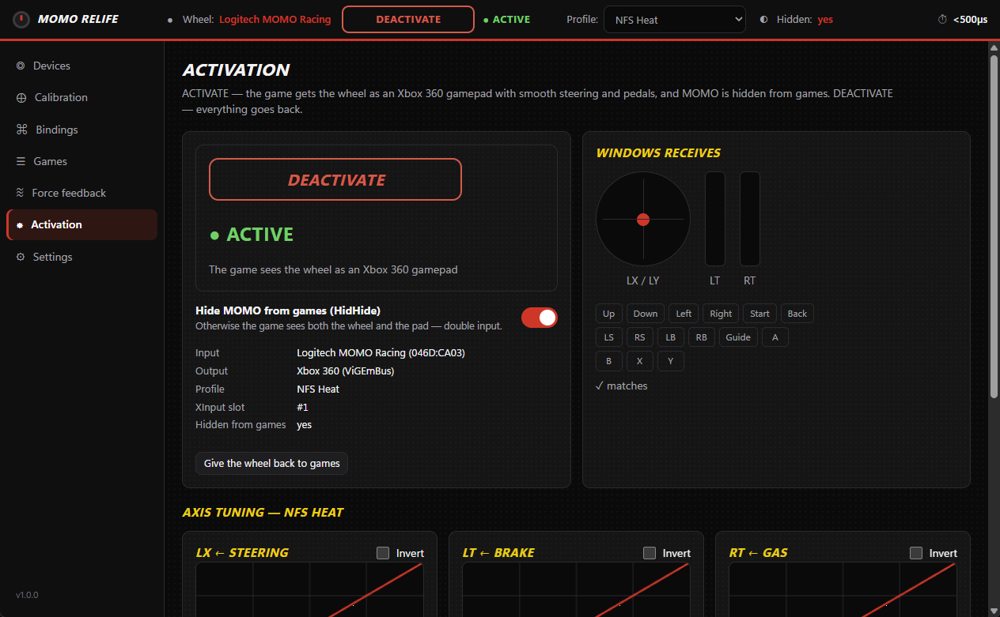
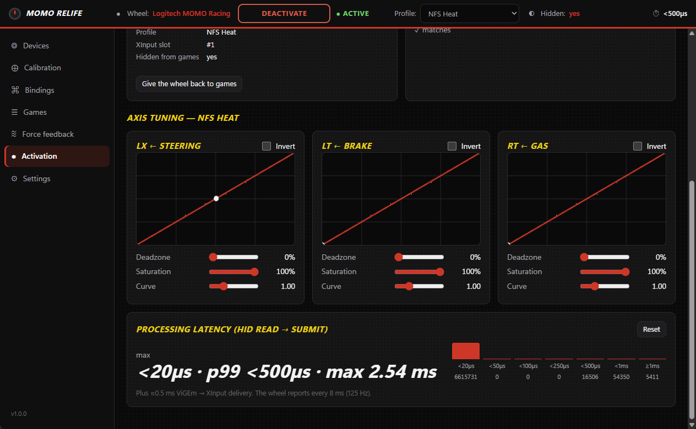
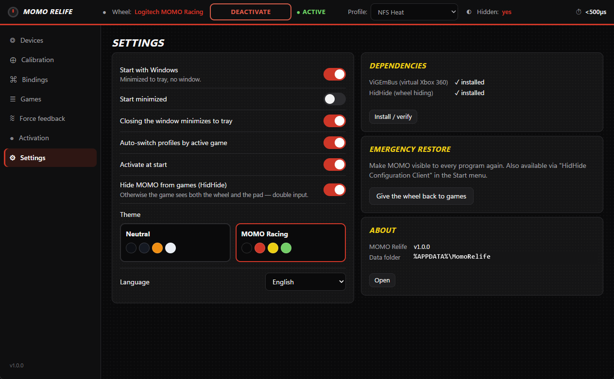

<div align="center">


# MOMO Relife

### A second life for the Logitech MOMO Racing wheel on Windows 10 / 11

Live input · Calibration wizard · Button remapping · 278 game profiles · Force feedback · One-click Xbox 360 gamepad mode

<br>

[](https://github.com/iseelikethis/momo_relife/releases/latest/download/MomoRelife-Setup-1.0.0.exe)

[](https://github.com/iseelikethis/momo_relife/releases/latest)
[](https://github.com/iseelikethis/momo_relife/releases)


**[All releases](https://github.com/iseelikethis/momo_relife/releases)** · **[Installation](#-installation)** · **[Antivirus warning?](#%EF%B8%8F-antivirus--smartscreen-warning)** · **[FAQ](#-troubleshooting)**

<br>



</div>

---

## Why

The MOMO Racing is a great force-feedback wheel, but its official software is long abandoned and modern games often don't recognise it at all. **MOMO Relife** brings it back:

- 🎮 **Every modern game works** — press **ACTIVATE** and the game sees your wheel as a standard **Xbox 360 gamepad** with smooth analog steering and separate gas / brake triggers.
- 🙈 **No double input** — while active, the real wheel is hidden from games (HidHide), so they only see the virtual pad.
- 🔁 **Profiles switch themselves** — 278 games are built in; start a game and its profile turns on automatically.
- 💪 **Force feedback is back** — centering spring, damper, friction, soft lock and shift kicks, computed by MOMO Relife.
- ⚡ **Zero added lag** — event-driven input path: under 20 µs of processing per report (plus ≈0.5 ms virtual-pad delivery). The wheel itself reports every 8 ms.
- ↩️ **Fully reversible** — **DEACTIVATE** and everything goes back to how it was.

> Made for the **Logitech MOMO Racing** force-feedback wheel (USB `046D:CA03`).

---

## ⬇ Download

| File | Size | |
|---|---|---|
| **[MomoRelife-Setup-1.0.0.exe](https://github.com/iseelikethis/momo_relife/releases/latest/download/MomoRelife-Setup-1.0.0.exe)** | 14.0 MB | Installer — app, 278 game profiles, drivers |
| [SHA256SUMS.txt](https://github.com/iseelikethis/momo_relife/releases/latest/download/SHA256SUMS.txt) | < 1 KB | Checksums |

**Requirements:** Windows 10 or 11, 64-bit · Logitech MOMO Racing wheel connected via USB.

---

## ✨ Features

### Devices — see exactly what the wheel sends

*(screenshot at the top of this page)*

- Live steering angle (270°), brake and gas, all **10 buttons and both paddles** — read straight from HID, no driver calibration in the way.
- Raw HID axes with min…max tracking.
- Connection diagnostics: report rate (≈125 Hz), report counter, disconnects, VID:PID, device instance.
- First-run checklist: **Connect → Check input → Calibrate → Choose game → Activate**.

### Calibration — a guided wizard



- Step-by-step wizard for steering (left stop → right stop → centre) and each pedal (released → pressed).
- It detects the axis automatically and warns about mistakes: no movement, wrong axis, reversed pedal, bad centre.
- Physical calibration is stored per wheel and shared by all profiles; **Factory** resets it in one click.
- Wheel rotation setting (MOMO Racing: 270°, stop to stop).
- **Physical → normalized → sent** table shows each step of the signal.
- **Virtual output check** — turn and press through the extremes; marks light up once Windows actually receives those values.

### Bindings — remap any button, instantly



- Click **Assign**, press a button or paddle on the wheel — done. Changes apply instantly, no restart.
- Map any wheel button to an **Xbox button** or a **keyboard key**.
- Map Xbox axes (LX / LY / RX / RY / LT / RT) to steering, gas or brake.
- Conflict warning when a button is already bound.
- Live test panel: press a button and see what Windows receives.

### Games — 278 profiles, auto-switching



- **278 games built in**, from classics to modern racers, plus your own — all in one searchable list.
- A profile turns on by itself when a game with that `.exe` starts. Add exact game paths for precise matching.
- Duplicate, rename, export and import profiles; built-in profiles are protected — editing one creates your own copy.
- **Import from the old Logitech Profiler** (`LwpDefault.xml`), with an import report.

### Force feedback — feel the road again



- **Centering spring** runs inside the wheel itself — it keeps working through Alt+Tab and game hangs.
- **Damper** (calms oscillation) and **friction** (the wheel's weight) computed by MOMO Relife.
- **Steering range** — a virtual lock: the game gets full lock before the physical stop, with a **soft lock** wall there.
- **Gear shift kick** — a short jolt when you press a paddle or shift.
- **Smooth start** — forces fade in after activation.
- One-click presets: **Soft · Balanced · Sport · Drift · Rally**. Settings are per game.



- **Safety:** force cap, force direction switch and left / right push tests.
- If the app ever crashes, a separate guard process removes the force from the motor.

> Force feedback works while **ACTIVE**. Effects are generated by MOMO Relife, not passed through from the game. Game vibration (grass, bumps) is planned for the next update.

### Activation — the one big button



- **ACTIVATE** — the game gets the wheel as an Xbox 360 gamepad (ViGEmBus) and MOMO is hidden from games (HidHide).
- **DEACTIVATE** — everything goes back.
- **Windows receives** panel shows the virtual pad live and confirms it matches.
- Also available from the tray icon, so you never need to open the window.



- **Axis tuning** per game: deadzone, saturation, response curve and invert for steering, brake and gas — with a live curve preview.
- **Latency meter:** live histogram of processing time from HID read to submit.

### Settings — set it and forget it



- Start with Windows (minimized to tray), close to tray, auto-switch profiles, activate at start.
- Driver status with one-click **Install / verify**.
- **Emergency restore** — make the wheel visible to every program again.
- Two themes: **Neutral** and **MOMO Racing**.
- 7 languages: English, Русский, Deutsch, Français, Italiano, Português (Brasil), Українська.

---

## 📦 Installation

1. [Download **MomoRelife-Setup-1.0.0.exe**](https://github.com/iseelikethis/momo_relife/releases/latest/download/MomoRelife-Setup-1.0.0.exe) and run it.
2. Choose components:

   | Component | |
   |---|---|
   | **MOMO Relife** | App, all 278 games, Start menu shortcuts. *Required.* |
   | **ViGEmBus** 1.22.0 | Virtual Xbox 360 gamepad driver — needed for **ACTIVATE**. |
   | **HidHide** 1.5.230 | Hides the wheel from games while active — no double input. |
   | Desktop shortcut | |
   | Start with Windows | Starts minimized to the tray. |
   | Diagnostics tool | Console wheel diagnostics (`probe.exe`) for support. |

3. Drivers install silently. If setup asks for a reboot — restart Windows.
4. Launch MOMO Relife, follow the checklist (**Connect → Check input → Calibrate → Choose game → Activate**) and drive.

---

## ⚠️ Antivirus / SmartScreen warning

Windows SmartScreen or your antivirus may show *"Unknown publisher"* or even flag the installer. This is a **false positive**: the program is new, has no paid code-signing certificate, and installs drivers.

- On the SmartScreen screen click **More info → Run anyway**.
- Check the files yourself on VirusTotal (70+ antivirus engines):
  - Installer: [VirusTotal report](https://www.virustotal.com/gui/file/f0e368386a6cf0d17ed37a54a9e7f7732d9068ade4dcb40858a15fd789b185a2)
  - App: [VirusTotal report](https://www.virustotal.com/gui/file/6d6b486212e16cf38e29d20ecc75a5d8dc6825b0360533cbae5c00e7a5299d1c)
- The ViGEmBus and HidHide drivers are signed by their author, Nefarius Software Solutions e.U.

**SHA-256 checksums**

```
f0e368386a6cf0d17ed37a54a9e7f7732d9068ade4dcb40858a15fd789b185a2  MomoRelife-Setup-1.0.0.exe
6d6b486212e16cf38e29d20ecc75a5d8dc6825b0360533cbae5c00e7a5299d1c  MomoRelife.exe (inside the installer)
```

Verify in PowerShell: `Get-FileHash .\MomoRelife-Setup-1.0.0.exe`

---

## 🛠 Troubleshooting

**The wheel "disappeared" from games or other programs**
It is still hidden by HidHide. Use any of these:
- **Start → MOMO Relife → Give the wheel back to games**
- In the app: **Settings → Give the wheel back to games**
- Tray icon → **Give the wheel back to games**
- **HidHide Configuration Client** from the Start menu

**The wheel is not found**
Check the USB cable and wheel power. Open *Game Controllers* (`joy.cpl`): if MOMO is listed there but the app can't see it, HidHide may be hiding it — use the restore option above.

**The wheel pushes the wrong way**
Force feedback → Safety → switch **Force direction** and use the push tests.

**Uninstall**
Settings → Apps → MOMO Relife → Uninstall. The wheel is automatically returned to games and autostart is removed. ViGEmBus and HidHide stay installed (other programs may use them) — remove them in the same place if you want.

---

## 🙏 Credits

- [ViGEmBus](https://github.com/nefarius/ViGEmBus) and [HidHide](https://github.com/nefarius/HidHide) by Nefarius Software Solutions e.U.
- Third-party components and licenses are listed in `THIRD-PARTY-NOTICES.txt` and the `licenses` folder installed with the app.

<sub>Logitech and MOMO are trademarks of their respective owners. MOMO Relife is an independent project, is not affiliated with or endorsed by Logitech, and does not use Logitech software or logos.</sub>
